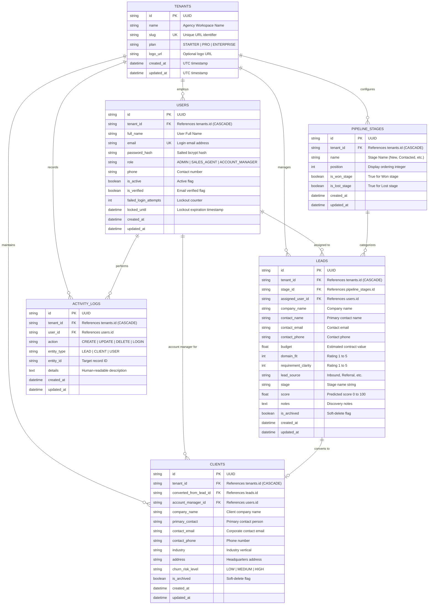

# Entity Relationship Diagram (ERD) — Midterm Release
## Project: IntelliCRM AI

This document specifies the relational data model for the IntelliCRM AI Midterm build.

---

## 1. Mermaid Entity Relationship Diagram

---

## 2. Table Specifications & Constraints

1. **Multi-Tenant Isolation:**
   - Every tenant-owned table (`users`, `leads`, `clients`, `pipeline_stages`, `activity_logs`) has a `tenant_id` foreign key with an `ON DELETE CASCADE` constraint and an explicit B-tree index for query isolation.
2. **Primary Keys:**
   - Universal UUIDv4 strings (36 characters) indexed as primary keys across all tables.
3. **Audit Timestamps:**
   - `created_at` and `updated_at` timestamps stored in UTC (`DateTime(timezone=True)`).
4. **Soft Deletion:**
   - `leads.is_archived` and `clients.is_archived` boolean flags preserve historical reference integrity.
